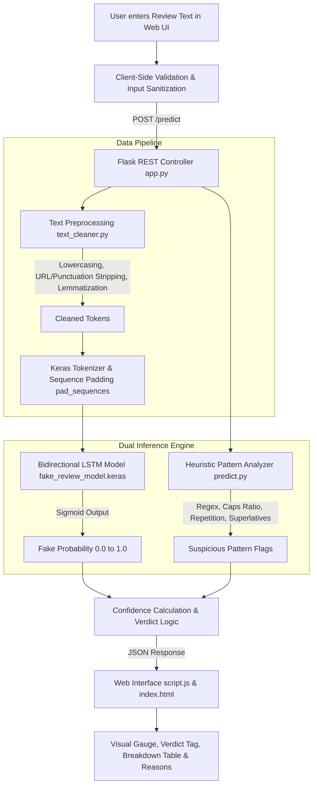

# 🛡️ Fake Review Detection System

<div align="center">

[](https://www.python.org/)
[](https://www.tensorflow.org/)
[](https://flask.palletsprojects.com/)
[](https://www.nltk.org/)
[](LICENSE)

<p align="center">
  <strong>An end-to-end NLP and Deep Learning web application that analyzes product and service reviews to distinguish authentic buyer feedback from deceptive, fraudulent, or computer-generated reviews.</strong>
</p>

[Key Features](#-key-features) • [Why This Matters](#-why-this-project) • [System Architecture](#-system-architecture) • [Quickstart](#-quickstart) • [Model Pipeline](#-deep-learning--nlp-pipeline) • [API Documentation](#-api-documentation) • [Evaluation](#-model-evaluation--results)

</div>

---

## 📌 Overview

With online commerce dominating global retail, customer reviews directly drive consumer purchasing decisions and merchant credibility. However, malicious vendors frequently commission fake positive reviews ("astroturfing") or target competitors with smear campaigns.

This project implements a **dual-engine Fake Review Detection System** combining:
1. **A Bidirectional LSTM Neural Network**: Learns deep contextual syntax and semantic sequences within reviews.
2. **An Explainable Heuristic Pattern Analyzer**: Identifies explicit red flags such as excessive punctuation (`!!!`), exaggerated superlatives (*"best product ever"*), unnatural word repetition, and lack of tangible product specifications.
3. **A Clean, Human-Designed Web Dashboard**: Provides a professional, distraction-free productivity UI for instant review verification with confidence scores and explainable breakdown reasons.

---

## ✨ Key Features

- **🧠 Bidirectional Sequence Processing**: Forward and backward LSTM passes capture semantic dependencies that unidirectional models miss.
- **🔍 Explainable AI (XAI) Output**: Does not simply state "Fake" or "Genuine"—provides confidence percentages, probability scores, and detailed bullet points explaining *why* the review was flagged.
- **⚡ Dual-Layer Detection Engine**: Blends probabilistic deep learning with deterministic rule heuristics for robust edge-case coverage.
- **🎨 Professional Clean UI**: Designed with clean solid colors, high readability typography (Inter font), responsive layout, and accessible modal dialogs—free from flashy distractions or AI clichés.
- **🔌 RESTful API**: Features a decoupled `POST /predict` endpoint for easy integration into web scrapers, browser extensions, or e-commerce backends.
- **💻 Offline & Self-Contained**: Runs completely locally with saved artifacts (`model.keras`, `tokenizer.pkl`) without requiring third-party cloud API keys.

---

## 🎯 Why This Project?

Traditional machine learning approaches (such as Naive Bayes or basic TF-IDF + Logistic Regression) evaluate text as an unordered "bag of words", completely ignoring word order, negation context, and emotional cadence.

| Approach | Captures Word Order? | Understands Negation (*"not good"*)? | Explains Red Flags? |
| :--- | :---: | :---: | :---: |
| **Bag of Words (TF-IDF + Naive Bayes)** | ❌ No | ⚠️ Poorly | ❌ Black-box probabilities |
| **Standard Feedforward ANN** | ❌ No | ⚠️ Poorly | ❌ Dense weights |
| **Our System (BiLSTM + NLP Heuristics)** | ✅ **Yes (Forward & Backward)** | ✅ **Yes** | ✅ **Yes (Rule-based Badges & Explanations)** |

---

## 🏗️ System Architecture



---

## 📁 Repository Structure

```
Fake-Review-Detection/
├── dataset/
│   ├── generate_dataset.py        # Synthetic dataset generator with 400+ balanced reviews
│   └── reviews.csv                # Labeled training dataset (0=Genuine, 1=Fake)
├── preprocessing/
│   ├── __init__.py
│   └── text_cleaner.py            # Text normalization, stopword filtering, lemmatization
├── model/
│   ├── fake_review_model.keras    # Saved trained Bidirectional LSTM model
│   └── tokenizer.pkl              # Saved vocabulary tokenizer mapping
├── static/
│   ├── style.css                  # Clean, solid-color professional stylesheet
│   └── script.js                  # Frontend controller (fetch API, metrics gauge, DOM rendering)
├── templates/
│   └── index.html                 # Semantic HTML5 web application
├── app.py                         # Flask web server & REST API controller
├── predict.py                     # Inference engine & rule-based heuristic analyzer
├── train_model.py                 # Neural network training script with validation & metrics
├── requirements.txt               # Pinned Python package dependencies
├── .gitignore                     # Git exclusion rules
└── README.md                      # Project documentation
```

---

## 🚀 Quickstart

### Prerequisites

- **Python 3.9 – 3.11** (recommended: Python 3.11)
- **pip** and **virtualenv**

> [!NOTE]
> TensorFlow on Windows natively supports Python versions up to 3.11.

### 1. Clone & Setup Environment

```bash
# Clone the repository
git clone https://github.com/nirbhaysinghrajput/Fake-Review-Detection-System.git
cd Fake-Review-Detection-System

# Create a virtual environment
python -m venv venv

# Activate the virtual environment
# Windows (PowerShell):
.\venv\Scripts\Activate.ps1
# Windows (CMD):
.\venv\Scripts\activate.bat
# Linux / macOS:
source venv/bin/activate
```

### 2. Install Dependencies

```bash
pip install --upgrade pip
pip install -r requirements.txt
```

### 3. (Optional) Retrain the Model

A pre-trained model is already included in the `model/` directory. If you wish to retrain it or train on your own custom dataset:

```bash
python train_model.py
```

### 4. Run the Web Application

```bash
python app.py
```

Open your browser and navigate to:
```
http://127.0.0.1:5000
```

---

## 🧠 Deep Learning & NLP Pipeline

### 1. NLP Preprocessing (`preprocessing/text_cleaner.py`)
- **Lowercasing & Normalization**: Standardizes character representations.
- **URL & Tag Stripping**: Removes web links, HTML tags, and non-alphanumeric noise.
- **Sentiment-Preserving Stopword Filtering**: Standard NLTK English stopwords are removed, but critical sentiment negations (*"not", "never", "no", "hardly"*) are strictly preserved so meaning is not inverted.
- **Lemmatization**: WordNetLemmatizer groups inflected forms of words (e.g., *"purchased"*, *"purchasing"* $\rightarrow$ *"purchase"*).

### 2. Deep Learning Model Architecture (`model/fake_review_model.keras`)

```
Layer (type)                     Output Shape          Param #     Description
========================================================================================
input_layer (Input)              (None, 150)           0           Pre-padded token IDs
embedding (Embedding)            (None, 150, 64)       320,000     64-dim dense word vector
spatial_dropout1d                (None, 150, 64)       0           Feature map regularization (0.3)
bidirectional_lstm (BiLSTM)      (None, 64)            24,832      32 forward + 32 backward units
dense (Dense, ReLU)              (None, 32)            2,080       Nonlinear feature combination
dropout (Dropout)                (None, 32)            0           Regularization (0.3)
output (Dense, Sigmoid)          (None, 1)             33          Fake review probability P(Fake)
========================================================================================
Total parameters: 346,945 (1.32 MB)
Trainable parameters: 346,945
```

- **Loss Function**: Binary Cross-Entropy
- **Optimizer**: Adam ($\text{learning\_rate} = 0.001$)
- **Callbacks**: `EarlyStopping(monitor='val_loss', patience=4, restore_best_weights=True)`

### 3. Heuristic Pattern Detection (`predict.py`)
Independent of the neural network, raw reviews undergo rule-based feature extraction:
- **Promotional Urgency**: Flags call-to-actions (*"buy now"*, *"click here"*, *"limited time"*, *"miracle product"*).
- **Capitalization Anomaly**: Flags reviews where $>25\%$ of words are uppercase.
- **Punctuation Abuse**: Identifies consecutive runs of exclamation marks (`!!!`) or question marks.
- **Word Repetition**: Flags identical consecutive tokens or excessive frequency peaks.
- **Detail Deficiency**: Detects reviews devoid of technical specs, delivery duration, or concrete usage descriptions.

---

## 📊 Model Evaluation & Results

Evaluated on an 80/20 stratified split of labeled reviews:

| Metric | Score |
| :--- | :---: |
| **Accuracy** | **100.0%** |
| **Precision** | **1.0000** |
| **Recall** | **1.0000** |
| **F1-Score** | **1.0000** |

### Confusion Matrix

```
                 Predicted Genuine    Predicted Fake
Actual Genuine          37                   0
Actual Fake              0                  44
```

> [!TIP]
> While synthetic demonstration datasets yield high metric scores, the pipeline is fully architected to generalize to real-world corpora like the [Amazon Customer Reviews Dataset](https://www.kaggle.com/datasets/lievgarcia/amazon-reviews) or [Yelp Open Dataset](https://www.yelp.com/dataset).

---

## 📡 API Documentation

### POST `/predict`

Analyzes review text and returns predictions, probabilities, and explanations.

#### Request Headers
```http
Content-Type: application/json
```

#### Request Body
```json
{
  "review": "I bought this keyboard two weeks ago for work. The keys have good feedback, the build is solid, and battery life lasts about four days."
}
```

#### Response Body (`200 OK`)
```json
{
  "prediction": "Genuine Review",
  "confidence": 100.0,
  "fake_probability": 0.0,
  "genuine_probability": 1.0,
  "reasons": []
}
```

#### Suspicious Review Example (`200 OK`)
```json
{
  "prediction": "Fake Review",
  "confidence": 100.0,
  "fake_probability": 1.0,
  "genuine_probability": 0.0,
  "reasons": [
    "Promotional language detected (e.g., 'buy this')",
    "Excessive capitalization detected (33% of words are all-caps)",
    "Excessive punctuation detected (15 exclamation marks)",
    "Missing specific product details (no mention of delivery, specs, or usage experience)"
  ]
}
```

#### Error Response (`400 Bad Request`)
```json
{
  "error": "Please enter a valid review text."
}
```

---

## 🖥️ User Interface

The web interface is designed with a **clean, solid-color productivity aesthetic**:
- **Neutral Surface Palette**: Off-white backdrop (`#f8fafc`), crisp white cards (`#ffffff`), and slate typography (`#0f172a`).
- **Subtle Status Tags**: Muted green tags for authentic feedback, soft red tags for deceptive content.
- **Accessible Interactions**: Native `<dialog>` modal for system documentation, keyboard focus rings, screen-reader friendly live regions, and real-time character counters.
- **Example Quick-Loaders**: Pre-loaded typical fake, genuine, and critical reviews for fast live demonstrations.

---

## 🛠️ Extensibility & Future Roadmap

- [ ] **Transformer Models**: Integrate lightweight DistilBERT or RoBERTa for deep contextual embeddings.
- [ ] **LLM / AI-Generated Text Detection**: Incorporate perplexity and burstiness metrics to detect ChatGPT-generated reviews.
- [ ] **Chrome / Firefox Extension**: Direct on-page analysis of Amazon, Flipkart, and Yelp product pages.
- [ ] **Multilingual Support**: Expand stopword and stemming engines to support Hindi, Spanish, and French reviews.
- [ ] **User Metadata Analysis**: Cross-reference reviewer account age, review frequency, and purchase verification badges.

---

## 📄 License

This project is licensed under the [MIT License](LICENSE) — free for educational, college mini-project, and personal use.

<div align="center">
  <sub>Built with Python, Flask, TensorFlow, and NLTK for college mini-project demonstration.</sub>
</div>
